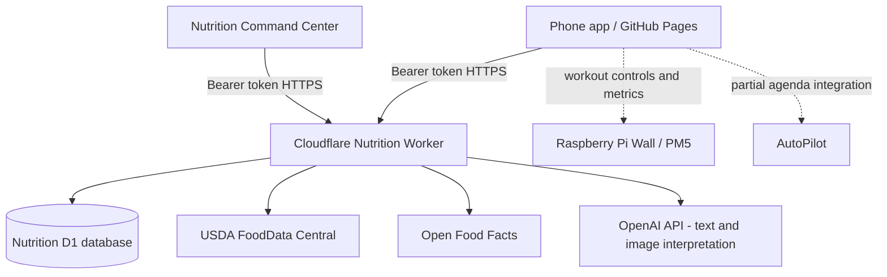

# Architecture and data flow

## Ownership and responsibility
- **Phone:** primary user experience, local food drafts, local history, pending mutation queue, macro displays, conversational review, camera UI.
- **Nutrition Worker:** authentication, CORS, records synchronization, food catalog search/ranking, external APIs, AI inference, usage ledger.
- **D1:** durable shared nutrition records, mutation idempotency, tombstones, food catalog/cache, AI usage ledger.
- **Nutrition Command Center:** occasional laptop review and administration; not intended as the primary logger.
- **Pi Wall:** exercise performance/ambient display and PM5 telemetry; independent release stream.

## Synchronization contract
- Phone saves locally first and attempts to upload after edits; retries when connectivity returns.
- Pull on page open, focus/visibility return, reconnect, and roughly 60-second intervals **while active**. Browser suspension prevents guaranteed background polling.
- `/v1/records` returns tombstones (`deleted=true`) and revisions. Client must apply them to its in-memory UI **and** persisted local state, not just one layer.
- Each mutation uses a stable ID and `expectedRevision` to detect concurrent edits. A `409` conflict requires explicit reconciliation; never blindly overwrite.
- Cloud-managed and legacy local-only entries must be distinguished; preserve unmatched local foods in a recoverable archive instead of deleting without review.
- The historic “protein shake” test demonstrated a real delete-sync failure. D1 contained two tombstones at revision 2 and one active `D1 sync verification` record; the phone still showed the deleted shake. The 7.18.1.3/7.18.1.4 fixes were generated but not conclusively validated in production.

## Search architecture
1. Search recent/verified personal catalog first.
2. Query cached external results, USDA, and Open Food Facts.
3. Normalize names, rank exact brand/product matches, deduplicate, abbreviate display names.
4. Show no-match states instead of unrelated results. Search is optional when free-text meal logging is faster.
5. User-reviewed entries are stored as foods/recipes; do not label model estimates as verified USDA data.

## AI interpretation
The v7.19.0 text endpoint asks an OpenAI model to infer item-level macro estimates from a description. This is **estimation**, not deterministic USDA nutrient matching. The phone presents editable results before saving. For future accuracy, add ingredient-level source provenance, serving uncertainty, and deterministic summation using verified nutrient records.
